# UI screenshots (visual guide)

Images live under [`../images/screenshots/`](../images/screenshots/). They are **copied into `docs_ai/`** so this folder stays self-contained (no dependency on marketing folders outside the docs tree).

For assistants: when a user asks “where is X?” or “what does Home look like?”, cite this page and the matching image.

---

## Phone — first run & Home

### Wizard: Welcome

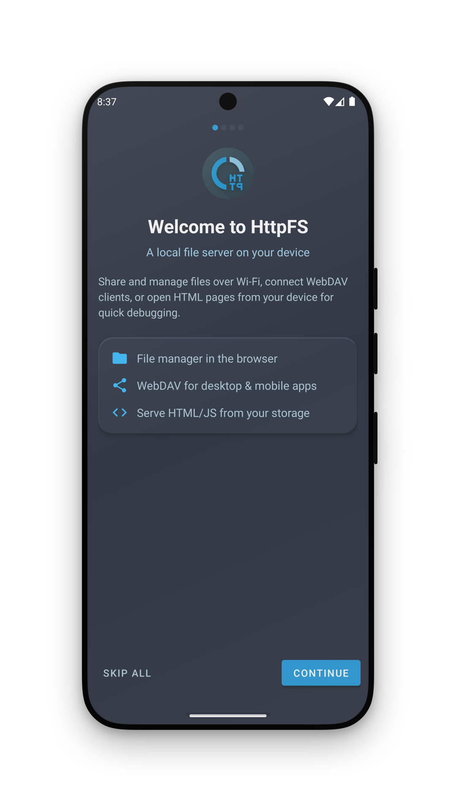

First-run step 1/4. Skip is allowed; everything can be changed later in Settings.

### Wizard: Interfaces

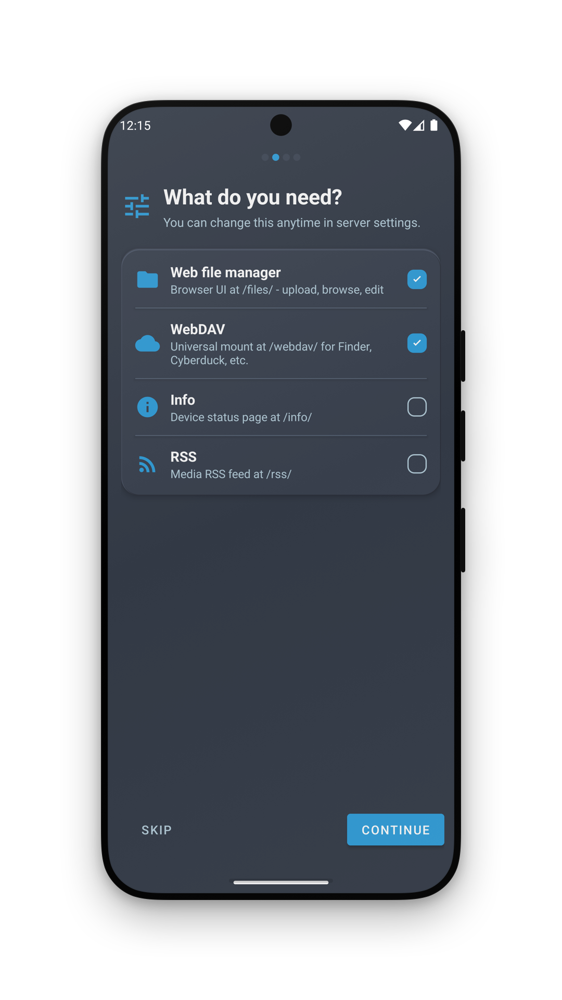

Choose which services to expose (Files UI, WebDAV, Info, RSS). Same toggles live under **Settings → Server → Interfaces**. FTP is configured later in Settings, not in the wizard.

### Home — server running

| Element | Meaning |
|---------|---------|
| Center ring **RUNNING** | Tap to stop |
| `host:port` | Advertised URL (use this for browser / rclone / HA) |
| Refresh / Address / Copy / QR / Share | Address helpers — same as [ui-map.md](ui-map.md) |
| Bottom tabs | Home · Settings · Info · (Logs when enabled) |

### Home — stopped / offline

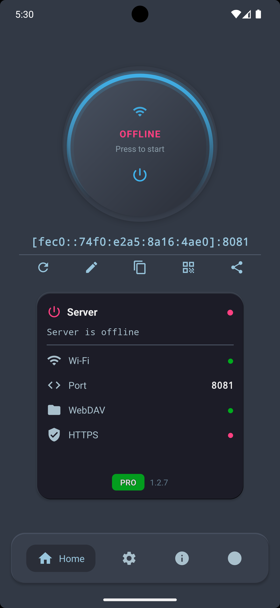

Server not running. Status chips (Wi‑Fi, WebDAV, HTTPS, …) show configuration at a glance. Pro badge may appear on Pro builds.

### Choose shared folder

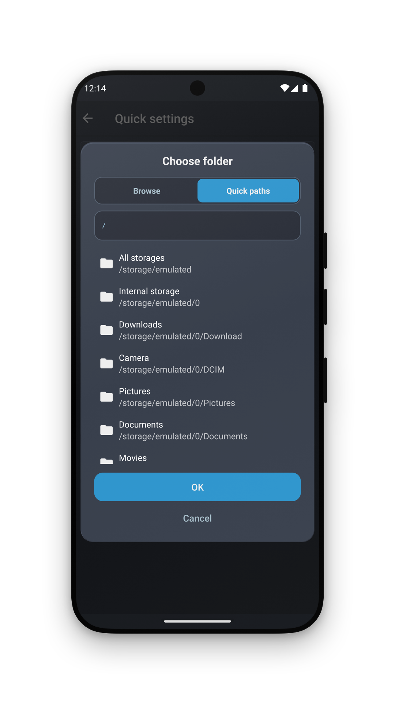

Quick paths / folder picker for **Shared folder** (Server root). Prefer a narrow folder when sharing with guests.

---

## Phone — Settings

### Settings hub

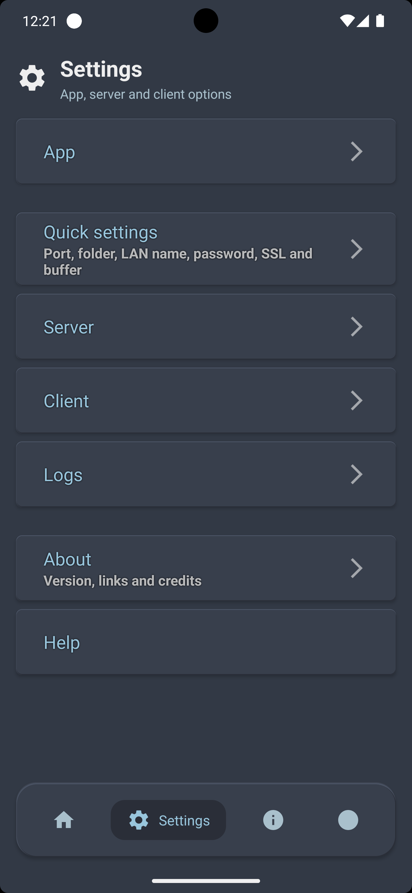

Categories: App / Server / Client (and nested screens). TV uses **Quick settings** for a short subset.

### Server → Address

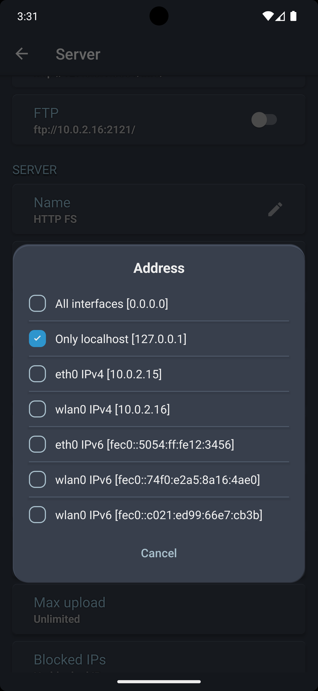

Bind / advertise mode:

- **All interfaces** (`0.0.0.0`) — default for LAN share
- **Only localhost** — device-only
- Specific `wlan0` / `eth0` / IPv6

Also opened from **Home → Address**. Details: [../features/network-address.md](../features/network-address.md).

### Server → security (password, HTTPS, users)

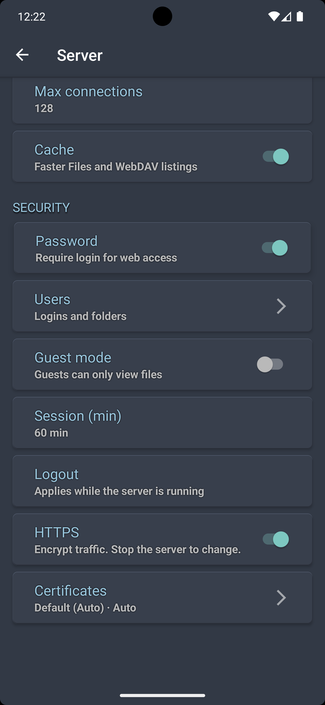

Password, Users, Guest mode, HTTPS / Certificates. For automation, prefer a named user + WebDAV Basic or session cookie — [../reference/api-automation.md](../reference/api-automation.md).

---

## Phone — Info & Logs

### In-app Info tab

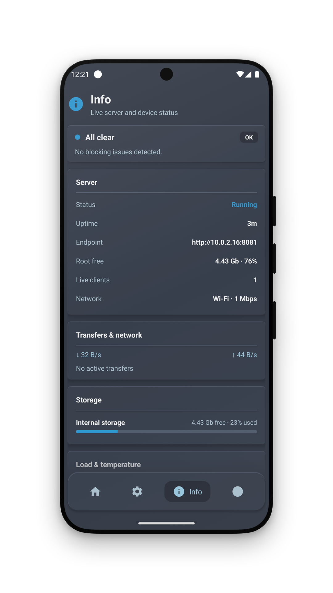

Live health on the **phone** (uptime, storage, transfers). **Not** the same as HTTP `/info/` (that needs Server → Interfaces → **Info** ON).

### Logs tab

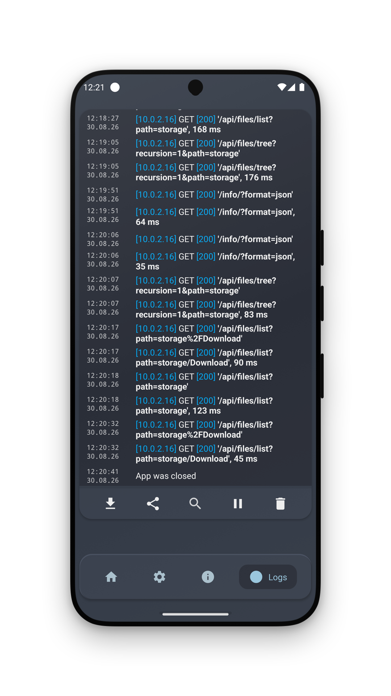

Request / server logs when App → Logs is enabled.

---

## Browser — web file manager (`/files/`)

### Desktop grid

Tree + breadcrumbs + Upload / Create / Search + grid/list. Full guide: [web-client.md](web-client.md).

### Volumes root

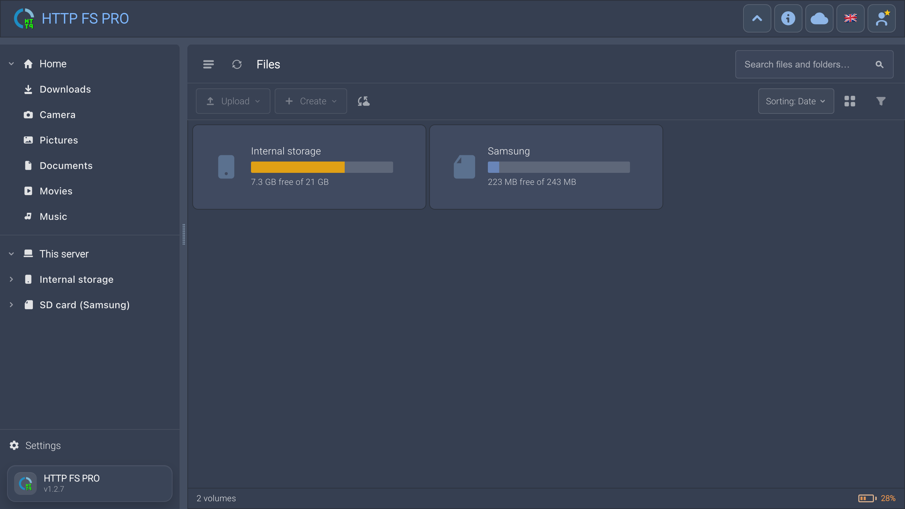

Multi-volume mode: Internal storage, SD card, free space per volume.

### Login

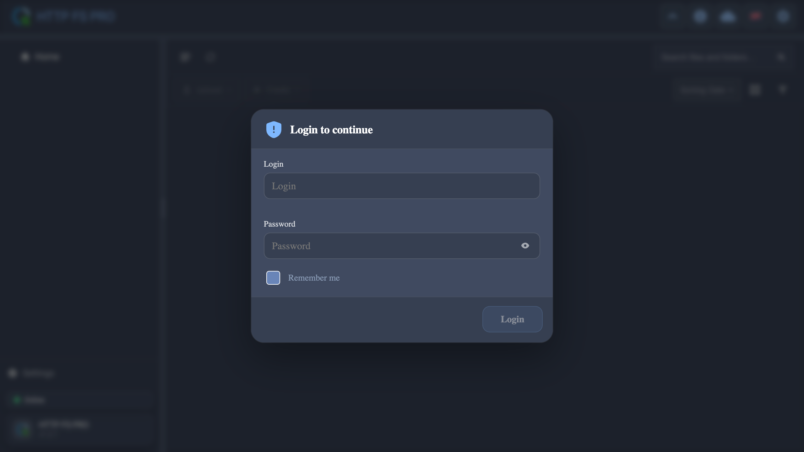

Shown when **Password** is on. Session cookie powers REST `/api/files/*`.

### Mobile browser

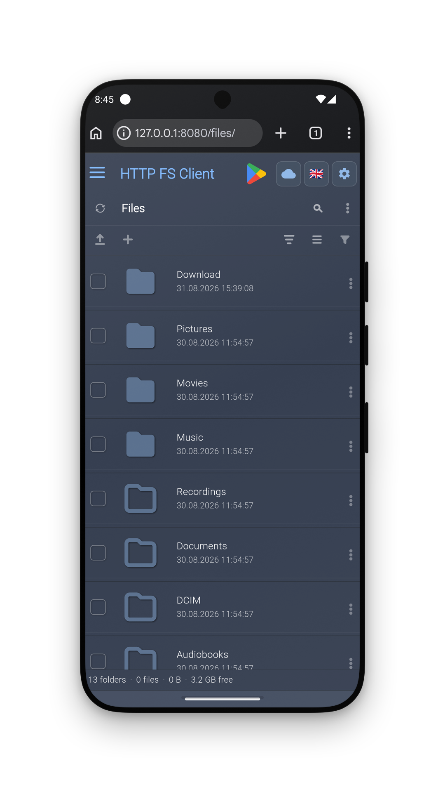

Same `/files/` UI in a phone browser (mockup). Useful when sharing via hotspot QR.

### Media preview

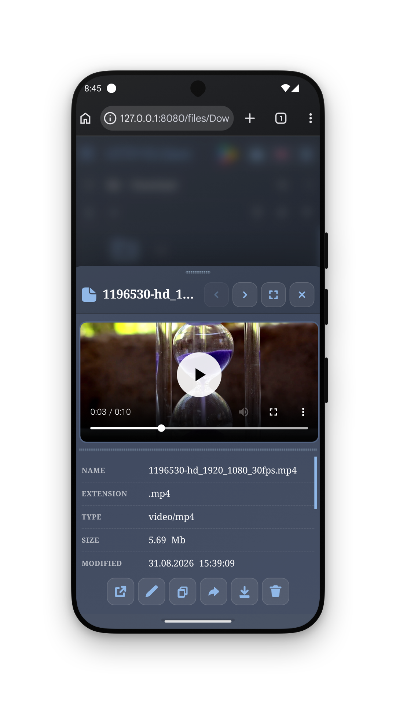

In-browser video/audio/image preview sheet.

### Mobile volumes (browser)

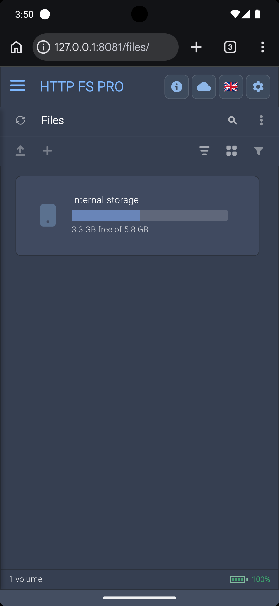

Volumes list on a narrow viewport.

### Desktop browser (Mac)

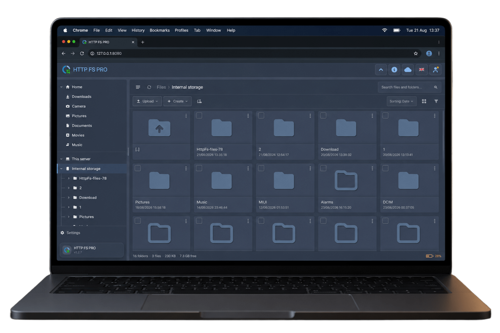

Typical PC browsing session against the phone server.

### HTTP Info page (`/info/`)

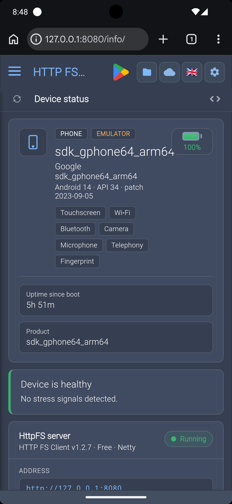

LAN dashboard in the browser when **Info** interface is enabled. JSON: `Accept: application/json` or `?format=json`.

---

## Android TV

### TV Home (stopped)

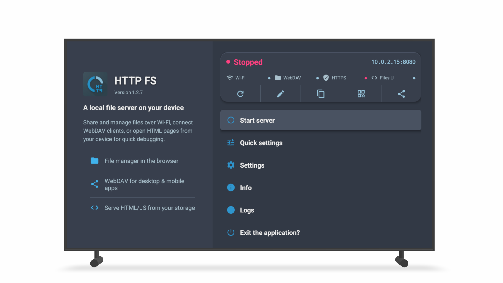

Guided Home: status card, address actions, **Start server**, Quick settings / Settings / Info / Logs / Exit. No bottom tabs — see [ui-map.md](ui-map.md).

### TV wizard welcome

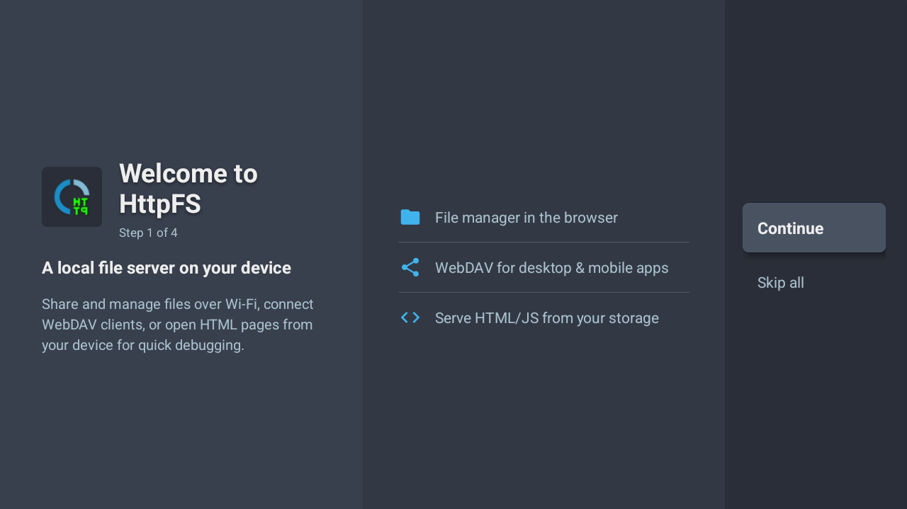

First-run welcome on Leanback.

### TV Home (alt)

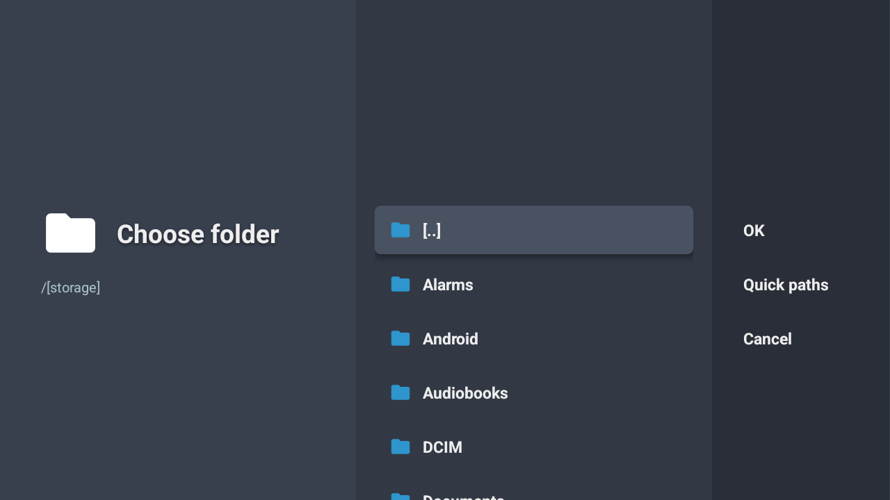

Additional TV Home / menu frame from Play assets.

---

## Branding

App icon (Free). Store links: [links.md](links.md).

---

## File index

| File | Screen |
|------|--------|
| `phone-wizard-welcome.png` | Wizard welcome |
| `phone-wizard-interfaces.png` | Wizard interfaces |
| `phone-home-running.png` | Home running + QR |
| `phone-home-offline.png` | Home stopped |
| `phone-choose-folder.png` | Shared folder picker |
| `phone-settings-hub.png` | Settings hub |
| `phone-server-address.png` | Address dialog |
| `phone-server-security.png` | Password / HTTPS / users |
| `phone-info-tab.png` | In-app Info |
| `phone-logs-tab.png` | Logs |
| `phone-web-files.png` | Web UI on phone (mockup) |
| `phone-web-preview.png` | Web media preview |
| `web-login.png` | Browser login |
| `web-volumes.png` | Browser volumes |
| `web-desktop-files.png` | Desktop file manager |
| `web-mobile-volumes.png` | Mobile browser volumes |
| `web-mac.png` | Browser on desktop OS |
| `web-info-page.png` | `/info/` in browser |
| `tv-home.png` | TV Home |
| `tv-wizard-welcome.png` | TV welcome |
| `tv-home-alt.png` | TV Home alt |
| `logo-512.png` | App icon |

---

## Related

- [ui-map.md](ui-map.md) · [getting-started.md](getting-started.md) · [web-client.md](web-client.md) · [why-and-use-cases.md](why-and-use-cases.md)
