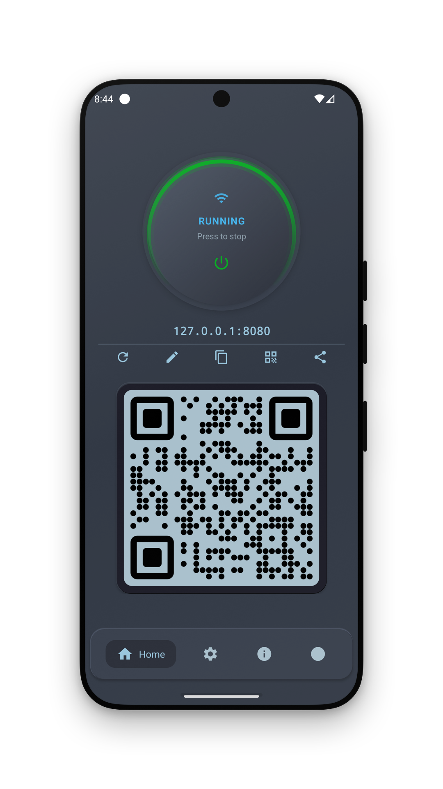

# UI map (where things live)

For assistants: map user words (“home”, “info”, “QR”, “address”) to the right screen before giving steps. **Visuals:** [screenshots.md](screenshots.md).

**Browser file manager** (`/files/` on a PC/phone browser) is a separate UI — see [web-client.md](web-client.md). This page is the **Android app**.

## Phone / tablet

### Bottom tabs

| Tab | Purpose |
|-----|---------|
| **Home** | Start/stop (center power), status card with `host:port`, address actions, optional flippable QR when running |
| **Settings** | Hub → App / Server / Client (and nested screens) |
| **Info** | **In-app** live health: server state, storage, load, active transfers |
| **Logs** | Request / server logs (only if App → Logs is on) |

### Home status card actions

| Control | Opens / does |
|---------|----------------|
| **Refresh** | Re-detect advertised LAN address |
| **Address** (edit) | Same dialog as Settings → Server → Address |
| **Copy** | Clipboard: full server URL |
| **QR** | Bottom-sheet QR + URL |
| **Share** | System share sheet |

Notification while running: shows URL + **Stop**.

### Settings hub

| Category | Typical questions it answers |
|----------|------------------------------|
| **App** | Language, start on boot/app open, logs, battery, ads (Free), storage grants, clear data |
| **Server** | Interfaces, Address, Port, Shared folder, LAN name, engine, Password/Users, HTTPS, blocked IPs, redirects (Pro), … |
| **Client** | Welcome text, hide files (Pro), thumbnails, folder size, connection check |

Nested from Server: Users, Certificates, Redirects, Hidden files, Blocked IPs, etc.

---

## Android TV

No bottom tabs. After wizard → **guided Home**:

| Area | Content |
|------|---------|
| Left | Branding (stopped) or large QR + URL (running) |
| Right status card | Running/Stopped, address, metrics (Wi‑Fi, WebDAV, HTTPS, Files UI), action row |
| Menu | Start/Stop, **Quick settings**, Settings, Info, Logs, Exit |

**Quick settings** (subtitle in UI): Port, Shared folder, LAN name, Password, HTTPS, Buffer — short path without full Settings tree.

Dialogs (alerts, lists, QR) are leanback bottom panels, not phone bottom sheets. Certificate list: **long-press** = Edit.

---

## First-run wizard

Shown once (can Skip). Same idea on phone and TV:

| Step | User choices |
|------|----------------|
| **Welcome** | Product intro |
| **What do you need?** (Interfaces) | Files UI, WebDAV, Info, RSS toggles (changeable later in Server → Interfaces) |
| **Permissions** | Storage / All files, Notifications, Battery optimization (grant or skip) |
| **Quick setup** | Port, root folder, optional initial file, optional password + user |

Finish → Home. Phone copy: start with the round center button. TV: **Start server** in the menu.

FTP is **not** in the wizard; enable later under Server → Interfaces.

---

## Two different “Info” surfaces

| Surface | What it is |
|---------|------------|
| **Info tab / TV → Info** | In-app dashboard (health, transfers, device). No browser needed. |
| **Server → Info** + `/info/` | Optional **HTTP** page for other devices on the LAN. Default **OFF**. |

Do not tell users to open `/info/` unless the Info **interface** toggle is on.

---

## Two different “QR” surfaces

| Surface | When |
|---------|------|
| Home / TV left panel QR | While server is **running** (TV left; phone may flip card) |
| Action **QR** button | Dialog/overlay anytime you need the current link |

Both encode the **advertised** server URL (scheme + host + port).

---

## Interfaces vs “network Address”

| Setting | Meaning |
|---------|---------|
| **Interfaces** (Files UI, WebDAV, RSS, Info, FTP) | Which **services/URLs** are enabled |
| **Address** | Which **IP/bind** clients should use |

Users often confuse these. “Turn on WebDAV” ≠ “pick Wi‑Fi IP”.

---

## Related

- Recipes: [recipes.md](recipes.md)
- Settings detail: [settings-guide.md](settings-guide.md)
- Connect URLs: [connect-clients.md](connect-clients.md)
- Screenshots: [screenshots.md](screenshots.md)
