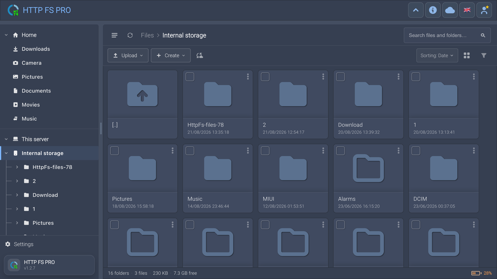

# Web file manager (browser UI)

The **Files UI** is a single-page app at **`/files/`** (or the server root `/` which redirects there). It runs in any modern desktop or mobile browser on the same network as the phone.



This is **not** the Android app (Home / Settings tabs). Use this doc when users ask about buttons, search, upload, preview, sync, or login **in the browser**.

More screenshots: [screenshots.md](screenshots.md). URLs: [connect-clients.md](connect-clients.md). Android app map: [ui-map.md](ui-map.md).

---

## Open the UI

1. Start the server on the phone (Home → Start).
2. On another device, same Wi‑Fi or hotspot, open `http://IP:PORT/files/` (or `https://…` if SSL is on).
3. If **Use password** is on, log in when prompted.

Optional: **Server → Client → Welcome dialog** shows a one-time message on first visit (Pro for custom text).

---

## Screen layout

```text
┌─ Header ─────────────────────────────────────────────┐
│ ☰  Brand   [Info] [WebDAV] [RSS]  Lang  Account/⚙  │
├─ Tree (desktop) │ Breadcrumbs + toolbar ─────────────┤
│                 │  path · Upload · Create · Search … │
│  folder tree    ├──────────────────────────────────┤
│                 │  Grid or list of files/folders     │
│                 ├──────────────────────────────────┤
│                 │  Status: N folders · M files · … │
└─────────────────┴──────────────────────────────────┘
  Transfer dock (bottom, when uploading/downloading)
  Overlays: Preview, Text editor, Settings, Account, dialogs
```

| Area | What it does |
|------|----------------|
| **Header** | App name, collapse header (desktop), shortcuts to **Info** / WebDAV / RSS when those interfaces are enabled on the server |
| **Tree** | Folder sidebar; **☰** on narrow screens opens it as a drawer |
| **Breadcrumbs bar** | Current path, **Upload**, **Create**, **Sort**, **View**, **Search**, **Refresh**, selection actions |
| **Listing** | Files and folders as grid or list; `[..]` parent row optional |
| **Status bar** | Counts and total size in the current view; optional **phone battery** chip (links to `/info/` when enabled) |
| **Transfer dock** | Progress for uploads, downloads, move/copy jobs |

Toggle **Info** in the header switches between **`/files/`** and **`/info/`** (browser device dashboard — only if Server → Interfaces → **Info** is ON).

---

## Login, guest, and account

| State | Header | Capabilities |
|-------|--------|----------------|
| **No password** (server) | ⚙ Settings | Follows server **Permissions** / Read-only / Guest access |
| **Guest** (password on, not logged in) | ⚙ Settings | Limited browsing per **Guest mode** rules |
| **Logged in** | Account (user icon) | User’s Read / Write / admin role |

**Account panel** (logged in):

- **Settings** — browser UI preferences (theme, dates, listing)
- **Change password**
- **Sync settings with the server** — theme, language, sort/view, listing options, folder-sync pair *names* follow the HttpFS user on the phone (see below)
- **Reset my settings** — clears synced prefs for this user
- **Log out**

**Admin** users see a star on the account icon. Server-side user management is still only in the **Android app** (Settings → Server → Users); the web UI does not yet edit users or server config.

---

## Two kinds of “settings”

Do not confuse them:

| Where | Controls |
|-------|----------|
| **Browser ⚙ / Account → Settings** | Theme, date/time format, grid/list, density, parent row, notices, open-with behavior, auto sync — stored in the browser and optionally **synced to the server** per user |
| **Android Settings → Client** | Welcome message, **device notices**, PWA install, thumbnails, folder sizes, hide files (Pro), connection-check WebSocket — affect what the **server sends** to all browsers |

**Reset web client settings** (Android **App** settings) clears stored browser prefs on the server side for cleanup; day-to-day prefs are managed in the browser or via Account sync.

### Sync settings with the server

When logged in and **Sync settings with the server** is ON:

- Changes debounce to `GET/PUT /api/files/prefs` on the phone.
- Opening the UI on another PC pulls the same theme, language, sort, view, etc.
- **Folder sync pairs**: server path + local folder *name* sync; the actual PC folder permission stays in that browser (File System Access API).
- After clearing browser cache, re-pick local sync folders on that computer.

Guests and anonymous sessions do **not** get server prefs files.

---

## Navigation

- **Click** a folder to open it; **`[..]`** goes up (if enabled in Settings).
- **Breadcrumbs** — tap a segment; on phone, tap the current folder name to open the full path menu.
- **Tree** — click folders; resizes on desktop (drag the splitter).
- **Browser Back/Forward** — history works within `/files/`.
- **Multi-volume root** — at `/files/` you see storage volumes (`internal`, SD, etc.); grant SD access on the phone if a volume shows inaccessible.

---

## Files: upload, create, edit

| Action | How |
|--------|-----|
| **Upload** | Toolbar **Upload** → files or folder (folder pick where the browser supports it) |
| **Create** | **+** → new folder or empty file (needs write access) |
| **Drag and drop** | Drag files onto a folder row or the listing (move/copy into that folder) |
| **Rename / Delete** | Right-click (or long-press) → context menu; or select + toolbar |
| **Copy / Cut / Paste** | Context menu; **Ctrl/Cmd+C/X/V**; paste also accepts files from the OS clipboard |
| **Move / Copy to…** | Context menu → opens folder picker + transfer review |
| **Download** | Context menu or selection toolbar |
| **Download as ZIP** | Context menu (multi-file) — uses server ZIP WebSocket |

Writes fail if the server is **Read-only**, the user is Read-only, the folder is read-only (e.g. some volumes), or **Max upload** is exceeded.

Uploads can **resume** after a network drop (partial upload tracked on server and in the browser).

---

## Sort, view, filter

- **Sort** — name, type, size, date; a‑Z / z‑A.
- **View** — grid or list; density S / L / XL.
- Sort and view sync with server prefs when account sync is on.

**Filter** in the “more” menu is reserved (not active yet).

---

## Search

Open: **Search** button, **Ctrl/Cmd+F**, or **`/`**.

| Option | Behavior |
|--------|----------|
| **This folder** | Search under the current path |
| **All** | From server root (all volumes the user can read) |
| Query | Plain name substring, glob (`*.jpg`), or `/regex/` |

Limits (server): about **300** matching files and **8000** folders scanned; then results are truncated (message in the breadcrumb bar).

While searching: results append in **found order** (as discovered). **Sort** stays available but does nothing until you pick a sort — then results reorder once. A floating panel shows the query, matches, folders scanned, current folder, progress bar, and **Stop**.

After search: summary shows **Found order** until you use **Sort**.

---

## Preview and text editor

**Open files with** (Settings): Preview (default), Download, or Menu only.

| Type | Behavior |
|------|----------|
| Images, video, audio | In-panel preview sheet |
| PDF | Embedded viewer |
| Text / code | Preview; editable types open in **text editor** (syntax highlight, wrap — synced in prefs) |
| Archives | Browse archive contents in preview where supported |
| Other | Download or open menu |

Double-click to open can be toggled in Settings.

---

## Folder sync (PC folder ↔ phone folder)

Syncs a **local directory on the computer** with a folder on the phone (two-way, with review options).

**Requirements (browser, not server setting):**

- **Chrome, Edge, or Opera**
- **Secure context**: `https://…` **or** `http://localhost` / `127.0.0.1`  
  Opening the phone by **`http://192.168.x.x`** alone is **not** enough — the browser blocks folder picker on plain HTTP LAN URLs.

**How to use:**

1. Context menu on a folder → **Sync…** (or badge on synced folders).
2. Pick the local folder once; pair is remembered (name synced via server prefs).
3. **Auto sync** and **Sync all** in Settings / toolbar when pairs exist.

For LAN HTTP, use WebDAV or manual upload/download instead, or serve the UI over HTTPS.

---

## Transfers and live updates

- **Transfer dock** — bottom panel for active jobs; can minimize/expand.
- **Live listing** — folder changes from other clients refresh via server events when connected.
- **Device notices** — toasts for phone battery/storage (if Server → Client → **Device notices** is ON and Settings → **Show device notices** in the browser).

Optional **Check connection socket** (Android Client settings): WebSocket “online” probe in the browser.

---

## Keyboard shortcuts

| Key | Action |
|-----|--------|
| **Ctrl/Cmd+F** or **/** | Open search |
| **Esc** | Close search, preview, settings, or clear selection |
| **F5** or **Ctrl/Cmd+R** | Refresh listing + tree |
| **Alt+← / Alt+→** | Browser back / forward |
| **Ctrl/Cmd+A** | Select all |
| **Ctrl/Cmd+C / X** | Copy / cut selection |
| **Ctrl/Cmd+V** | Paste files or staged copy |
| **Delete** | Delete selection |
| **Backspace** | Delete selection, or go to parent folder |

Shortcuts are disabled while typing in inputs or the text editor.

---

## Context menu (right-click / long-press)

Typical entries (depend on file type and permissions):

- Open, Preview, Edit (text)
- Download, Download as ZIP
- Copy, Cut, Paste, Move to…, Copy to…
- Rename, Delete
- **Sync…** (folders, when browser supports it)
- Properties-style actions via listing metadata (size, date)

Empty area menu: Upload, Create, Refresh, Sort, View, Sync all (if paired).

---

## Onboarding

First visit may show a short **tour** highlighting tree, upload, and account. Completion is stored in synced prefs.

---

## Install as app (PWA)

If **Installable web app** is ON in Android Client settings **and** the certificate is **trusted** (e.g. Let’s Encrypt), Chrome may offer “Install”. Self-signed HTTPS from the app usually **does not** qualify.

---

## Troubleshooting (browser)

| Problem | Check |
|---------|--------|
| Blank or 404 | **Files UI** enabled; correct `http` vs `https`; URL includes `/files/` |
| Login loop | Password enabled — use a valid user; cookies allowed |
| Cannot upload | Read-only server/user; guest without Write; folder not writable |
| Sync folder greyed / error | Need HTTPS or localhost; Chrome/Edge/Opera only |
| Search feels stuck on “Loading…” | Large tree — wait; truncated after limits; see Search section above |
| Settings don’t follow to another PC | Log in; enable **Sync settings with the server** |
| Thumbnails missing | Server → Client → **Thumbnails**; try refresh |
| “Offline” indicator | Enable connection check in Client settings; network drop |

More: [safety-and-faq.md](safety-and-faq.md) · [settings-guide.md](settings-guide.md) (Client section) · [recipes.md](recipes.md).

---

## Related

- Connect URLs: [connect-clients.md](connect-clients.md)
- Server Client toggles: [settings-guide.md](settings-guide.md) § Client
- API (advanced): [../reference/api-routes.md](../reference/api-routes.md)
- WebSocket events: [../reference/websocket-events.md](../reference/websocket-events.md)
